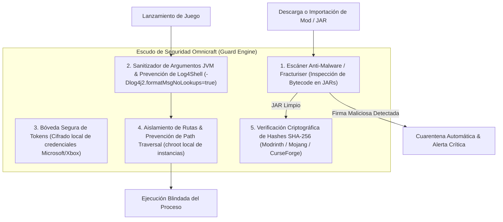
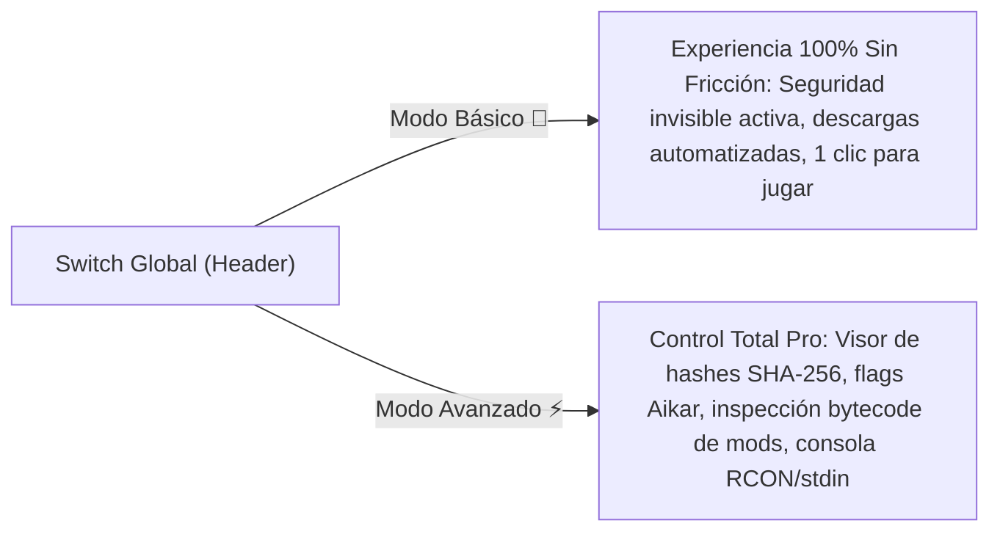

# Plan de Acción PLUS ULTRA 100% — Omnicraft Launcher Studio v1.0
## Blindaje, Arquitectura Dual (Básico / Avanzado) y Ciberseguridad Integral

Este documento define la hoja de ruta definitiva para alcanzar el **100% absoluto de madurez técnica**, incorporando una capa **PLUS ULTRA de Ciberseguridad, Sandbox y Blindaje Anti-Exploit** para proteger al usuario contra malware en mods (ataques tipo Fracturiser/BleedingPipe), robo de tokens de sesión, inyección de comandos en terminales y corrupción de datos.

---

## 🛡️ Núcleo de Ciberseguridad y Blindaje Anti-Hackeo (Plus Ultra)

---

## 📌 Arquitectura del Switch Global (Modo Básico ↔ Modo Avanzado)

---

## 🚀 Fases de Ejecución Priorizadas

### 🟢 Fase 0: Núcleo del Switch Global, Verificador de Versiones y Blindaje Base
- [ ] **0.1. Switch Global de Interfaz (🌱 Básico / ⚡ Avanzado):**
  - Persistencia de `ui_mode` en SQLite (`settings`).
  - Toggle intuitivo en el Header de la aplicación.
  - Adaptación condicional de todos los formularios, diagnósticos y herramientas avanzadas.
- [ ] **0.2. Verificador Criptográfico de Actualizaciones de Omnicraft:**
  - Consulta del release feed oficial con verificación de firmas / checksums SHA-256.
  - Modal informativo con changelog en Markdown y botón de actualización directa.
- [ ] **0.3. Blindaje Base del Motor de Lanzamiento (`engine`):**
  - **Inmunización Log4Shell activa por defecto:** Forzar `-Dlog4j2.formatMsgNoLookups=true` en todas las versiones vulnerables (Minecraft 1.7 a 1.18.1).
  - **Sanitización estricta de JVM Args:** Prevenir inyección de comandos shell (`rm`, `wget`, `bash -c`, `;`, `&&`, `|`) dentro del campo de argumentos de JVM personalizados.
  - **Protección contra Path Traversal:** Validar que los nombres de instancias, mundos y archivos nunca contengan secuencias `../` o caracteres nulos.

---

### 🟢 Fase 1: Escáner Anti-Malware y Tienda Segura (Prioridad Crítica)
- [ ] **1.1. Escáner Nativo Anti-Fracturiser / BleedingPipe en Rust:**
  - Servicio `MalwareScannerService` que analiza archivos `.jar` antes de ejecutarlos:
    - Inspección de nombres de clases sospechosas asociadas a la campaña de malware *Fracturiser* (ej. `dev.sk1er`, `bytebuddy` infectados, URLs de IP directas en el bytecode).
    - Detección de sockets de red no autorizados en mods del cliente.
    - Bloqueo preventivo y puesta en cuarentena (`.jar.quarantine`) con alerta roja en pantalla.
- [ ] **1.2. Verificación de Integridad SHA-512 / SHA-1 en Tienda:**
  - Comprobación criptográfica del archivo descargado de Modrinth / CurseForge contra el hash oficial entregado por su API antes de ubicarlo en la carpeta `mods/`.
- [ ] **1.3. Resolución Automática de Dependencias en Tienda:**
  - *Modo Básico:* Descarga e instalación en segundo plano de librerías obligatorias (`Fabric API`, `Cloth Config`, etc.).
  - *Modo Avanzado:* Inspector de dependencias con árbol jerárquico de versiones.
- [ ] **1.4. Restauración Segura de Backups de Mundos con 1 Clic:**
  - Comando `restore_world_backup` con backup preventivo instantáneo antes de sobreescribir datos.

---

### 🟡 Fase 2: Automatización de Modloaders, Servidores Dedicados y Terminal Segura
- [ ] **2.1. Instalador Automatizado de Fabric / Quilt Loader:**
  - Descarga nativa vía `meta.fabricmc.net` sin requerir instaladores Java externos.
- [ ] **2.2. Descargador Automático de Server JARs (PaperMC / Purpur / Vanilla):**
  - Descarga con 1 clic de compilaciones oficiales con validación de hashes.
- [ ] **2.3. Consola Interactiva Segura para Servidores (Stdin / Comandos en Vivo):**
  - Sanitización de entradas para evitar inyección en subshells del host.
  - Terminal integrada con salida coloreada y comandos directos (`/whitelist`, `/op`, `/stop`).

---

### 🟠 Fase 3: Skin Studio 3D Profesional y Blindaje de Texturas
- [ ] **3.1. Pintado 3D Directo sobre la Malla (Raycasting Three.js):**
  - Pintado por proyección directa en la geometría 3D del personaje con cálculo de coordenadas UV.
- [ ] **3.2. Selector de Capas (Capa Base ↔ Capa Exterior / 2da Capa):**
  - Soporte completo para sombreros, chaquetas y mangas 3D con transparencias.
- [ ] **3.3. Sanitizador de Texturas PNG:**
  - Validación de que los archivos de skin importados sean exactamente imágenes PNG válidas de 64x64 o 64x32 píxeles, eliminando metadatos EXIF o payloads incrustados (evitando exploits de desbordamiento de búfer en librerías de imagen).

---

### 🔵 Fase 4: Autonomía de Cuentas Blindada y Descargador JRE
- [ ] **4.1. Flujo OAuth2 Microsoft Nativo (Device Code Flow Seguro):**
  - Autenticación oficial sin navegador embebido riesgoso, usando el código oficial de Microsoft (`microsoft.com/link`).
  - Almacenamiento cifrado de tokens en base de datos local SQLite o keyring del sistema operativo.
- [ ] **4.2. Descargador Automático de Java OpenJDK (Adoptium API):**
  - Descarga y extracción desatendida de Java 8, 17 y 21 en `~/.omnicraft_studio/runtimes/` con verificación de SHA-256.

---

## 📋 Matriz Comparativa: Modo Básico vs Modo Avanzado con Seguridad

| Módulo | Modo Básico (Casual) | Modo Avanzado (Pro/Dev/Creator) | Capa de Seguridad (Plus Ultra) |
| :--- | :--- | :--- | :--- |
| **Instancias** | Nombre, icono y versión en 1 clic | Flags JVM, Aikar presets, selección Java manual | Aislamiento estricto de carpetas y sanitización anti-inyección |
| **Mods** | Búsqueda e instalación transparente con dependencias | Toggle `.disabled`, visor de dependencias y hashes | **Escáner Anti-Fracturiser** y verificación SHA-512 |
| **Mundos** | Jugar y respaldar en 1 clic | Restaurar backup, editor de semilla, clonado | Descompresión segura contra ataques Zip-Bomb / Traversal |
| **Servidores** | Descarga Paper auto y arranca | Terminal interactiva de comandos, puertos y Xms/Xmx | Sanitización de comandos stdin y binding de IP seguro |
| **Skins** | Selección Steve/Alex, pintar 2D/3D, inyectar | Pintado 3D Raycasting, edición 2da capa, UV export | Validación de dimensiones 64x64 y purga de payloads EXIF |
| **Logs** | Semáforo de salud ("Juego estable" / "Fallo") | Visor 500 líneas, filtro Regex, parser de cuelgues | Ofuscación automática de tokens o IPs en los reportes |
| **Actualizador** | Aviso limpio "Nueva versión disponible" | Changelog completo, hashes de compilación y diff | Firmas criptográficas para prevenir suplantación de binario |
| **Cuentas** | Iniciar sesión y ver avatar | Gestión de perfiles, UUIDs e inyección offline | Tokens de autenticación protegidos en almacén cifrado |
